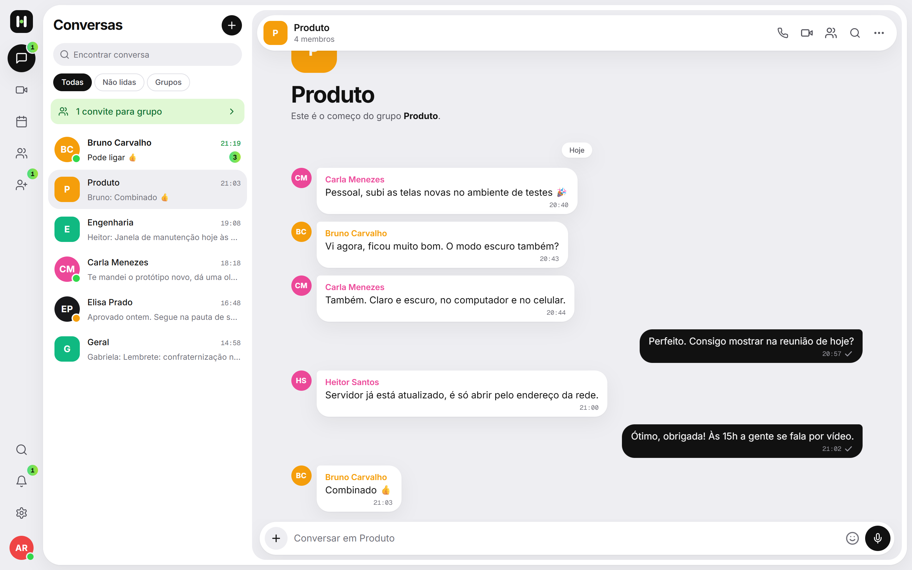
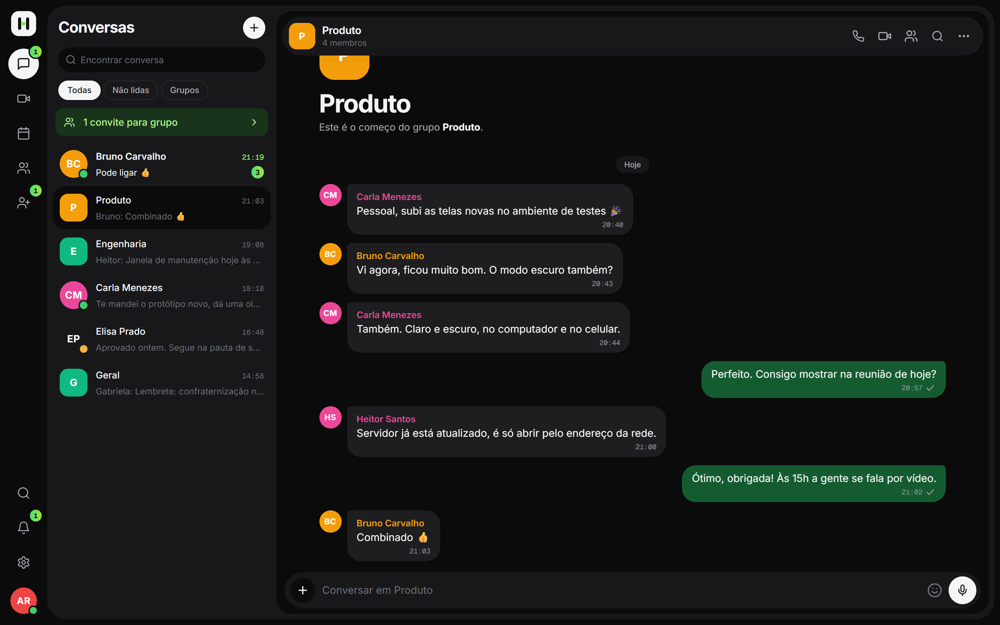
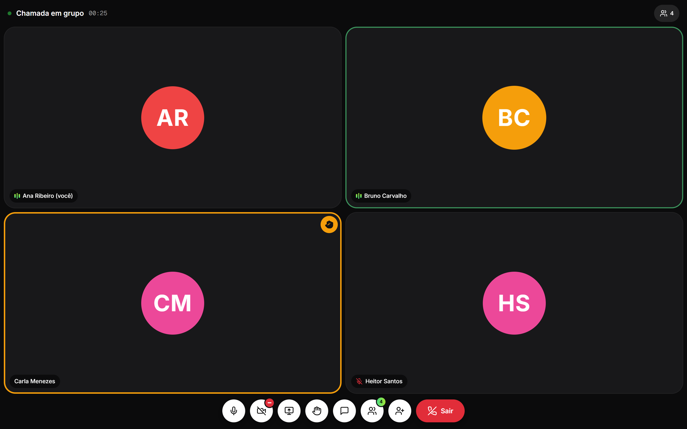
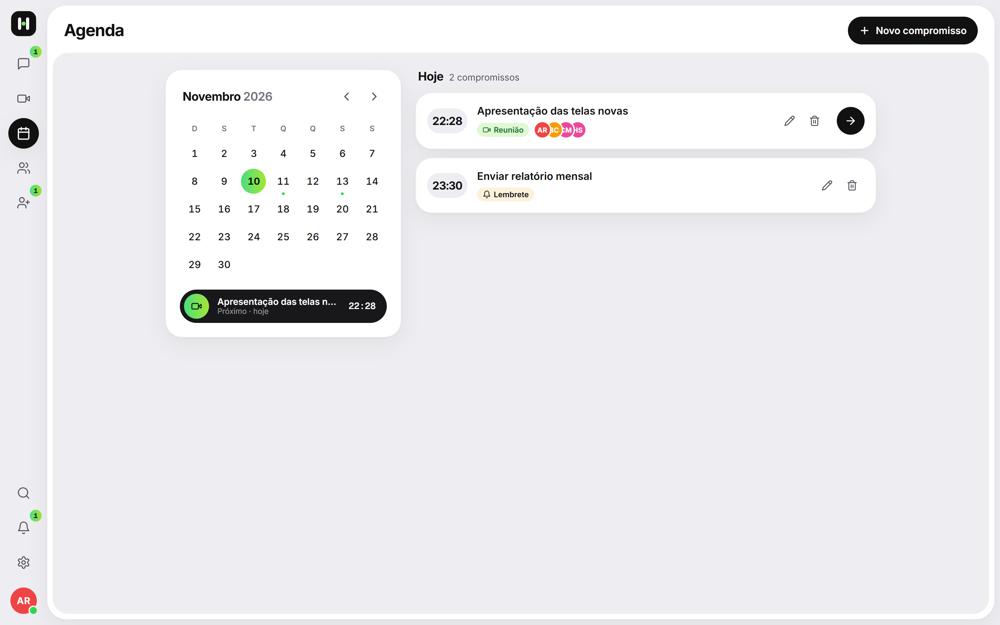
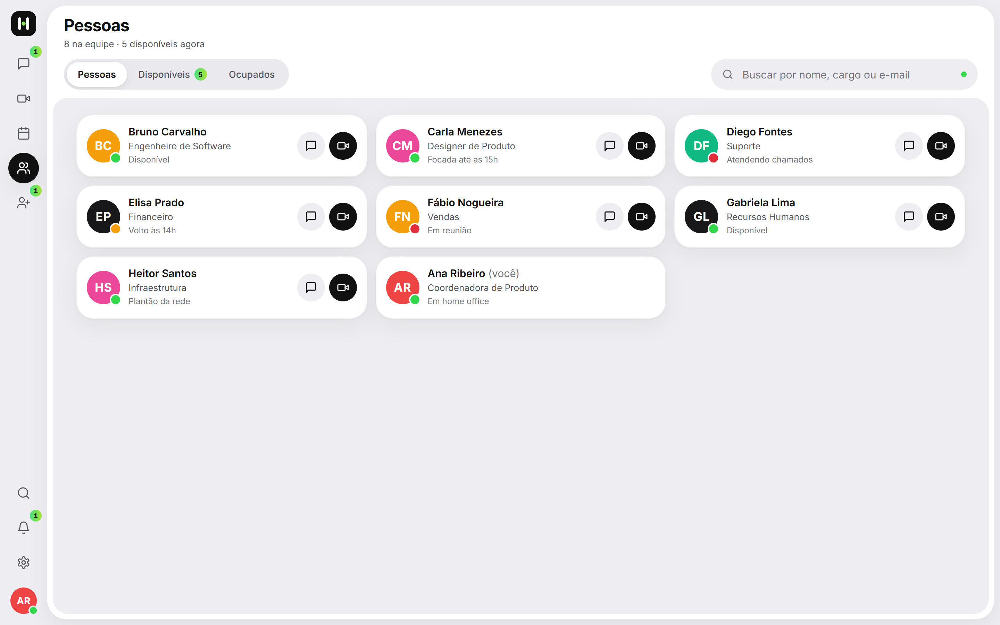
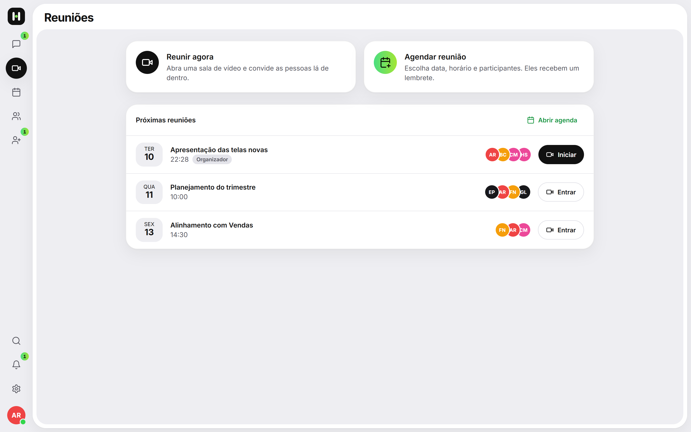
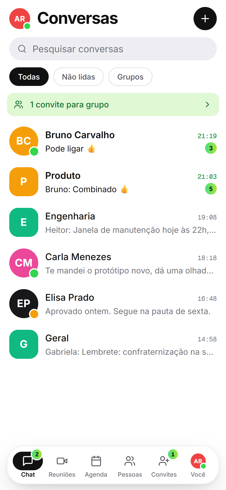
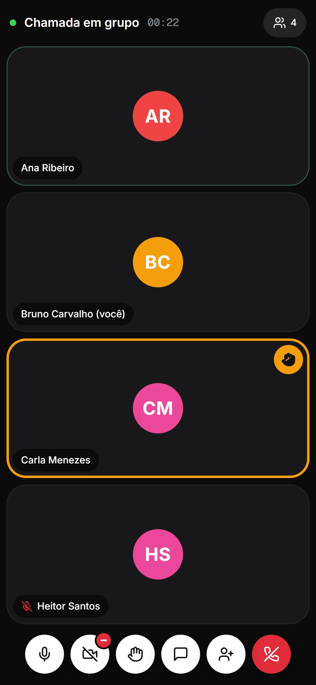
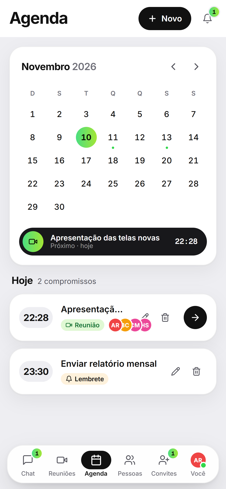

<div align="center">


# Hubify

**Chat, chamadas e reuniões dentro da rede da sua empresa.**

Um app só para a equipe conversar, ligar e se reunir, rodando no seu próprio servidor.


<br />


</div>

<br />

## Índice

- [O que é](#o-que-é)
- [Recursos](#recursos)
- [Telas](#telas)
- [Subir com Docker (passo a passo)](#subir-com-docker-passo-a-passo)
- [Primeiro acesso](#primeiro-acesso)
- [Rede, HTTPS e aplicativo](#rede-https-e-aplicativo)
- [Subir sem Docker](#subir-sem-docker)
- [Configuração (.env)](#configuração-env)
- [Como funciona por dentro](#como-funciona-por-dentro)
- [Segurança](#segurança)
- [Licença](#licença)

## O que é

O Hubify é uma plataforma de comunicação interna. Ele fica instalado em uma máquina da empresa e as pessoas acessam pelo navegador do computador ou do celular, usando o endereço dessa máquina na rede.

Conversas, arquivos e chamadas ficam no seu servidor. O uso do dia a dia (chat, chamadas, reuniões) funciona sem internet; só as notificações push dependem dela.

## Recursos

| | |
|---|---|
| **Conversas** | Mensagens diretas e grupos, confirmação de leitura, "digitando", respostas, edição, encaminhamento, anexos e busca rápida (`Ctrl + K`). |
| **Mensagens de voz** | Grave e envie áudio direto da conversa. |
| **Chamadas** | Áudio e vídeo entre duas pessoas, com toque para quem recebe. |
| **Reuniões em grupo** | Grade que se adapta ao número de pessoas, compartilhamento de tela, mão levantada e chat da chamada. O convite chega como aviso discreto, sem tocar. |
| **Agenda** | Reuniões agendadas com convidados e lembretes pessoais. |
| **Pessoas** | Diretório da equipe com status (disponível, ocupado, em reunião, ausente) e status personalizado. |
| **Aplicativo** | Instala no computador, Android e iPhone (PWA), com notificações push. |
| **Aparência** | Tema claro, escuro ou automático, no mesmo visual em qualquer tela. |

## Telas

<table>
  <tr>
    <td width="50%"><br /><sub>Conversa em grupo</sub></td>
    <td width="50%"><br /><sub>Tema escuro</sub></td>
  </tr>
  <tr>
    <td><br /><sub>Chamada em grupo</sub></td>
    <td><br /><sub>Agenda</sub></td>
  </tr>
  <tr>
    <td><br /><sub>Pessoas</sub></td>
    <td><br /><sub>Reuniões</sub></td>
  </tr>
</table>

<p align="center">
  
  
  
  
  
</p>

<sub>As capturas usam pessoas e mensagens fictícias.</sub>

## Subir com Docker (passo a passo)

Você precisa de **uma máquina que fique ligada** na rede da empresa (ela será o servidor) e do **Docker** instalado nela. Não é preciso instalar Java, Node nem banco de dados: o Docker cuida de tudo.

### Antes de começar: instale o Docker

- **Windows ou Mac:** instale o [Docker Desktop](https://www.docker.com/products/docker-desktop/) e abra-o uma vez. Espere aparecer "Engine running".
- **Linux:** instale o [Docker Engine](https://docs.docker.com/engine/install/) com o plugin Compose.

Para conferir, abra um terminal e rode:

```bash
docker --version
docker compose version
```

Se os dois comandos mostrarem um número de versão, está pronto.

### Jeito mais fácil (Windows): dois cliques

1. Baixe o projeto (botão **Code → Download ZIP** no GitHub) e extraia em uma pasta.
2. Dê dois cliques em **`Iniciar com Docker.bat`** e aceite o pedido de administrador.
3. Espere. A primeira vez leva alguns minutos, porque o Docker baixa e monta tudo.
4. No fim, a janela mostra o endereço para acessar, por exemplo `https://192.168.0.10`.

O script descobre o IP da máquina, cria o arquivo `.env`, libera as portas no firewall e sobe os serviços. Para desligar, use **`Parar Docker.bat`** (os dados são mantidos).

### Jeito manual (Windows, Mac ou Linux)

**1. Baixe o projeto**

```bash
git clone https://github.com/andreygiordane/hubify-app.git
cd hubify-app
```

**2. Descubra o IP da máquina na rede**

É o endereço que as outras pessoas vão digitar no navegador.

```bash
ipconfig        # Windows: procure "Endereço IPv4"
hostname -I     # Linux
ipconfig getifaddr en0   # Mac
```

O resultado é algo como `192.168.0.10`.

**3. Crie o arquivo de configuração**

```bash
cp .env.example .env
```

Abra o `.env` e coloque o IP do passo anterior em `HUBIFY_HOSTS`:

```env
HUBIFY_HOSTS=192.168.0.10
```

Esse endereço entra no certificado de segurança (HTTPS). Se a máquina tiver mais de um IP ou um nome na rede, separe por vírgula: `HUBIFY_HOSTS=192.168.0.10,hubify.local`.

**4. Suba os serviços**

```bash
docker compose up -d --build
```

- `up` liga os serviços.
- `-d` deixa rodando em segundo plano (você pode fechar o terminal).
- `--build` monta o Hubify a partir do código. Só demora na primeira vez.

**5. Confira se subiu**

```bash
docker compose ps
```

Devem aparecer quatro serviços com status `Up`:

| Serviço | O que faz |
|---|---|
| `hubify-frontend` | O site e a porta de entrada da rede (HTTPS) |
| `hubify-backend` | Contas, mensagens e agenda |
| `hubify-video-server` | Entrega de mensagens em tempo real, chamadas e push |
| `hubify-db` | Banco de dados (PostgreSQL) |

**6. Abra no navegador**

| Onde | Endereço |
|---|---|
| Qualquer aparelho da rede | `https://IP-DO-SERVIDOR` |
| Na própria máquina do servidor | `http://localhost:5173` |

**7. Libere o firewall (se outros aparelhos não conectarem)**

Permita a entrada nas portas **443** (o app) e **80** (redireciona para o HTTPS e entrega o certificado). No Windows, o `Iniciar com Docker.bat` já faz isso.

### Comandos do dia a dia

```bash
docker compose ps                 # ver o que está rodando
docker compose logs -f            # acompanhar os registros (Ctrl + C para sair)
docker compose down               # desligar (os dados são mantidos)
docker compose up -d              # ligar de novo
git pull && docker compose up -d --build   # atualizar para a versão mais nova
```

> ⚠️ `docker compose down -v` apaga os volumes: banco de dados, certificado e chaves de notificação. Só use se quiser começar do zero.

### Onde ficam os dados

| Volume | Conteúdo |
|---|---|
| `hubify-db-data` | Contas, mensagens, grupos e agenda |
| `hubify-certs` | Autoridade certificadora local e certificado do site |
| `hubify-push` | Chaves e assinaturas das notificações push |

Inclua esses três volumes no backup.

### Deu problema?

| Sintoma | O que fazer |
|---|---|
| `port is already allocated` | Outra aplicação usa a porta 443 ou 80. Defina `HUBIFY_HTTPS_PORT=8443` e/ou `HUBIFY_HTTP_PORT=8081` no `.env` e suba de novo. |
| "Sua conexão não é particular" | É esperado no primeiro acesso de cada aparelho. Veja [HTTPS sem aviso](#https-sem-aviso-sua-conexão-não-é-particular). |
| Outros aparelhos não abrem o endereço | Confira o firewall (portas 443 e 80) e se o aparelho está na mesma rede. |
| A página abre mas não entra | Espere um minuto após subir: o backend demora um pouco na primeira vez. Veja `docker compose logs backend`. |
| Câmera ou microfone não funcionam | O navegador só libera com HTTPS confiável. Instale o certificado no aparelho. |

## Primeiro acesso

1. Abra `https://IP-DO-SERVIDOR` e toque em **Criar conta**.
2. Informe nome, usuário, e-mail e uma senha com 8 caracteres, número, letra maiúscula e símbolo.
3. Peça para as outras pessoas fazerem o mesmo. Elas aparecem em **Pessoas** assim que criam a conta.
4. Para tirar o aviso do navegador e poder instalar o app, siga a seção abaixo em cada aparelho.

## Rede, HTTPS e aplicativo

O HTTPS é obrigatório porque os navegadores só liberam **microfone e câmera**, a **instalação como aplicativo** e as **notificações** em conexões seguras.

### HTTPS sem aviso ("sua conexão não é particular")

Na primeira subida o servidor cria uma **autoridade certificadora local** (`hubify-ca.crt`) e, com ela, assina o certificado do site. O navegador só mostra o aviso enquanto o aparelho não conhece essa autoridade. Instale o arquivo **uma única vez em cada aparelho** e o aviso some de vez, inclusive quando o IP do servidor mudar (o certificado do site é refeito sozinho; a autoridade continua a mesma).

Baixe o arquivo pelo próprio servidor, por HTTP:

| Como o servidor foi iniciado | Endereço do certificado |
|------|----------|
| Docker | `http://IP-DO-SERVIDOR/hubify-ca.crt` |
| `Iniciar Servidor.bat` (sem Docker) | `http://IP-DO-SERVIDOR:8080/hubify-ca.crt` |

Depois instale conforme o aparelho:

- **Windows (Chrome/Edge):** abra o arquivo → *Instalar Certificado* → *Máquina Local* → *Colocar todos os certificados no repositório a seguir* → **Autoridades de Certificação Raiz Confiáveis**. Ou, num terminal de administrador: `certutil -addstore -f Root hubify-ca.crt`. Feche e abra o navegador.
- **Android:** Configurações → Segurança → Criptografia e credenciais → *Instalar um certificado* → **Certificado de CA** → escolha o arquivo baixado.
- **iPhone/iPad:** abra o endereço no Safari e permita o download do perfil → Ajustes → *Perfil baixado* → Instalar. Depois, Ajustes → Geral → Sobre → **Ajustes de Confiança de Certificado** → ative "Hubify CA local".
- **macOS:** abra o arquivo no Acesso às Chaves (chaveiro *Sistema*) → clique duas vezes no certificado → Confiança → **Sempre confiar**.
- **Firefox:** Configurações → Privacidade e Segurança → Certificados → *Ver certificados* → Autoridades → **Importar**.

Em muitos computadores Windows de um domínio, distribua o `hubify-ca.crt` por GPO (Configuração do Computador → Políticas → Configurações do Windows → Configurações de Segurança → Políticas de Chave Pública → Autoridades de Certificação Raiz Confiáveis).

Outras formas de não ter o aviso:

- **CA interna da empresa:** se a empresa já tem uma, emita um certificado para o nome/IP do servidor e substitua `hubify.crt`/`hubify.key` (Docker, volume `hubify-certs`) ou `server.crt`/`server.key` (sem Docker, pasta `servidor-dados/certificado`).
- **Certificado público (Let's Encrypt, sem instalar nada nos aparelhos):** exige um domínio real. Crie um registro DNS como `hubify.suaempresa.com.br` apontando para o IP interno do servidor e emita o certificado pelo **desafio DNS-01** (o único que funciona sem expor o servidor à internet), por exemplo com `certbot certonly --manual --preferred-challenges dns -d hubify.suaempresa.com.br` ou com o plugin do seu provedor de DNS para renovar sozinho. Depois copie `fullchain.pem` → `hubify.crt` e `privkey.pem` → `hubify.key` (Docker, volume `hubify-certs`) ou `server.crt`/`server.key` (sem Docker), coloque o domínio em `HUBIFY_HOSTS` e acesse sempre pelo nome, não pelo IP. O certificado vale 90 dias: automatize a renovação.

**Erros comuns do navegador**

| Erro | Causa | Correção |
|------|-------|----------|
| `ERR_CERT_AUTHORITY_INVALID` | O aparelho não conhece a autoridade que assinou o certificado | Instalar o `hubify-ca.crt` (acima) ou usar certificado público |
| `ERR_CERT_COMMON_NAME_INVALID` | O endereço digitado não está no certificado | Acrescentar o IP/nome em `HUBIFY_HOSTS` no `.env` e subir de novo (sem Docker, os IPs da máquina entram sozinhos) |
| `ERR_CERT_DATE_INVALID` | Data/hora do aparelho errada | Ajustar o relógio do aparelho |

**Somente HTTPS**

- A porta 80 não entrega o aplicativo: só redireciona para o HTTPS e serve o `hubify-ca.crt`. Se a porta 80 já estiver ocupada na máquina, defina `HUBIFY_HTTP_PORT` no `.env`. Sem Docker, o mesmo papel é da porta HTTP do servidor (`-PortaHttp 80` no `iniciar-servidor.ps1`).
- `http://localhost:5173` continua existindo apenas na própria máquina do servidor.
- **HSTS** (`HUBIFY_HSTS=1`): faz o navegador exigir HTTPS confiável neste endereço por um ano. Ligue só depois que **todos** os aparelhos já abrirem o Hubify sem aviso: com HSTS o navegador remove o botão "continuar mesmo assim", e quem ainda não instalou o certificado fica sem acesso. Navegadores ignoram HSTS em endereços por IP; ele vale quando o acesso é por nome.

> Guarde a pasta do certificado nos backups. Se `hubify-ca.key` for apagado, uma nova autoridade é criada e todos os aparelhos precisam instalar o novo `hubify-ca.crt`. Nunca compartilhe o arquivo `.key`: só o `.crt` vai para os aparelhos.

### Notificações push

Com as notificações ativadas (o Hubify oferece ao entrar, ou em Configurações → Notificações), o aparelho avisa sobre mensagens, chamadas e convites de reunião mesmo com o app fechado.

- As chaves VAPID são criadas na primeira subida e ficam guardadas (Docker: volume `hubify-push`; sem Docker: `video-server/push-data`), junto das assinaturas dos aparelhos. Inclua essa pasta no backup: se as chaves forem perdidas, cada pessoa precisa ativar as notificações de novo.
- **Requer internet no servidor e nos aparelhos.** A entrega passa pelos serviços de push dos navegadores (Google, Mozilla, Apple). O conteúdo vai criptografado de ponta a ponta para o aparelho, mas o tráfego sai da rede interna. Em rede sem internet o push não funciona; o app continua avisando por dentro (som, selo, avisos na tela e notificação do sistema enquanto estiver aberto em segundo plano).
- **iPhone/iPad (iOS 16.4+):** só funciona no app adicionado à Tela de Início. Abra o Hubify por esse ícone e toque em "Ativar notificações".
- Requer o HTTPS confiável da seção acima.

### Convites de reunião x chamadas

- **Chamada direta (1:1):** toca em tela cheia para quem recebe, como antes.
- **Chamada de grupo, reunião ou convite feito de dentro de uma sala:** não toca. A pessoa recebe um aviso discreto (e um push) com o nome da sala e o botão **Entrar**, que some sozinho em 45 segundos.

### Instalar como aplicativo (desktop, Android e iOS)

O Hubify é um PWA: pode ser instalado e abrir em janela própria, com ícone na área de trabalho ou na tela inicial. Requer o HTTPS confiável da seção acima (com o aviso de certificado o navegador não oferece a instalação).

- **Computador (Chrome/Edge):** ícone de instalar no fim da barra de endereço, ou o botão **Instalar o aplicativo** na tela de login, ou Configurações → **Instalar aplicativo**.
- **Android (Chrome):** menu ⋮ → *Instalar app* (ou o mesmo botão dentro do Hubify).
- **iPhone/iPad (Safari):** Compartilhar → *Adicionar à Tela de Início*.

Se a empresa tiver sub-redes/VLANs que não se enxergam, suba o TURN local: `docker compose --profile turn up -d` (veja `.env.example`).

## Subir sem Docker

Para testar em um computador com Windows, sem instalar o Docker: dê dois cliques em **`Iniciar Servidor.bat`**. Ele precisa de **Java 25 (JDK)** e **Node.js 18+**, monta o projeto na primeira execução e usa um banco em arquivo na pasta `servidor-dados`. Deixe a janela aberta enquanto o Hubify estiver em uso.

## Configuração (.env)

Todas as opções ficam no arquivo `.env`, na raiz do projeto. Só a primeira é obrigatória.

| Variável | Padrão | Para que serve |
|---|---|---|
| `HUBIFY_HOSTS` | (vazio) | IPs e nomes pelos quais o servidor é acessado. Entram no certificado HTTPS. |
| `HUBIFY_HTTPS_PORT` | `443` | Porta do app na rede. |
| `HUBIFY_HTTP_PORT` | `80` | Porta que redireciona para o HTTPS e entrega o `hubify-ca.crt`. |
| `HUBIFY_HSTS` | (desligado) | `1` faz o navegador exigir HTTPS confiável. Ligue só depois que todos os aparelhos abrirem sem aviso. |
| `VAPID_SUBJECT` | `mailto:admin@hubify.local` | Contato informado aos serviços de push. |
| `TURN_URLS`, `TURN_SECRET`, `TURN_EXTERNAL_IP` | (vazio) | Só para redes com sub-redes que não se enxergam. Suba com `docker compose --profile turn up -d`. |

## Como funciona por dentro

```
                 Rede da empresa
                        │
              https://IP-DO-SERVIDOR
                        │
              ┌─────────▼─────────┐
              │      frontend     │  nginx: site (React) + HTTPS
              │  portas 443 e 80  │  repassa /api, /socket.io e /push
              └────┬─────────┬────┘
                   │         │
        ┌──────────▼──┐  ┌───▼──────────────┐
        │   backend   │  │   video-server   │
        │ Spring Boot │◄─┤ Node + Socket.IO │  mensagens em tempo real,
        │  API REST   │  │ sinalização WebRTC│  chamadas e push
        └──────┬──────┘  └──────────────────┘
               │
        ┌──────▼──────┐
        │ PostgreSQL  │
        └─────────────┘
```

As chamadas de áudio e vídeo trafegam direto entre os aparelhos (WebRTC ponto a ponto); o servidor só faz a apresentação entre eles.

| Parte | Tecnologia |
|---|---|
| Interface | React 18, Vite, Tailwind CSS, Framer Motion |
| Tempo real | Socket.IO e WebRTC |
| API | Java 25, Spring Boot 4, JPA |
| Banco | PostgreSQL 15 (Docker) ou H2 em arquivo (sem Docker) |
| Entrada da rede | nginx com HTTPS e autoridade certificadora local |

```
hubify-app/
├── frontend/        Interface (React) e configuração do nginx
├── backend/         API REST (Spring Boot)
├── video-server/    Tempo real, chamadas e push (Node)
├── docs/            Capturas de tela
├── docker-compose.yml
├── .env.example
├── Iniciar com Docker.bat / Parar Docker.bat
└── Iniciar Servidor.bat          (execução sem Docker)
```

## Segurança

O Hubify foi feito para **redes internas confiáveis**. Antes de usar, saiba que:

- A API ainda **não exige autenticação por token**: quem está na rede e conhece os endereços da API consegue ler e alterar dados sem passar pela tela de login. Não exponha o servidor à internet.
- As senhas são guardadas com hash (BCrypt).
- O tráfego entre os aparelhos e o servidor é criptografado por HTTPS, e as chamadas por WebRTC (DTLS-SRTP).
- Guarde em local seguro o volume `hubify-certs`: quem tiver a chave da autoridade local pode emitir certificados aceitos pelos aparelhos que a instalaram.

## Licença

Distribuído sob a [licença MIT](LICENSE): pode usar, modificar e redistribuir, inclusive comercialmente, mantendo o aviso de direitos autorais.

## Autor

Feito por **Andrey Giordane** · [@andreygiordane](https://github.com/andreygiordane)
